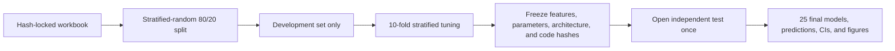

# NephroTox traditional ML and DNN benchmark

Reproducible nephrotoxicity modeling across **five molecular representations and five algorithms (25 combinations)**. The current protocol uses a stratified-random 80:20 split, development-only 10-fold model selection, and a one-time independent-test evaluation after all choices are locked.

This directory is the curated GitHub subset of the full reproducibility archive. Source code, tests, data, frozen feature matrices, selected hyperparameters, model-level metrics, predictions, summary tables, and GitHub-friendly figures are retained. Large trained-model binaries, fold-level OOF matrices, training logs, inspection files, and TIFF exports are omitted; see the repository-level cleanup notes in `../README.md`.

## Study design

- Dataset: 1,853 unique compounds (931 nephrotoxic, 922 reference-negative).
- Development set: 1,482 compounds (745 positive, 737 negative).
- Locked test set: 371 compounds (186 positive, 185 negative).
- Holdout: stratified random 80% development / 20% independent test (seed `20260810`).
- Model selection: 10-fold `StratifiedKFold` within the development set.
- Representations: Morgan, MACCS, AtomPair, TopologicalTorsion, and 166 frozen RDKit descriptors.
- Algorithms: RF, SVM, MLP, XGBoost, and a PyTorch DNN.
- Final outcomes: ROC-AUC, ACC, sensitivity, specificity, precision, F1, MCC, balanced accuracy, and bootstrap 95% CIs. PR-AUC and calibration metrics are retained as secondary outcomes.
- Chemical-space audit: maximum training-test Morgan Tanimoto similarity and a development-derived applicability-domain analysis for the CV-selected MACCS-RF primary model and the test-best Descriptor-RF descriptive model.

The detailed analysis contract is in [docs/MODELING_PROTOCOL.md](docs/MODELING_PROTOCOL.md). Data provenance and limitations are described in [docs/DATA_CARD.md](docs/DATA_CARD.md), and model artifacts are described in [docs/MODEL_CARD.md](docs/MODEL_CARD.md).

## Leakage-resistant workflow



The test labels are stored separately from the development table. Tuning never opens the test-label file. `scripts/04_evaluate_locked_test.py` refuses to run until all 25 development experiments are complete and the lock manifest matches the current source, configuration, features, and split.

## Installation

Python 3.11 or newer is required. The reference run used Python 3.14.5.

```bash
python -m venv .venv

# Windows
.venv\Scripts\activate

python -m pip install --upgrade pip
python -m pip install -e .
```

If RDKit or PyTorch wheels are unavailable for a particular Python release, use a current conda environment and install the packages listed in `requirements.txt`.

## Reproduce the analysis

Run the controlled stages from the repository root:

```bash
# 1. Validate the workbook and create the immutable stratified split
python scripts/00_prepare_data.py

# 2. Generate the five frozen feature matrices
python scripts/01_generate_features.py

# 3. Tune all 25 combinations using development-only 10-fold CV
python scripts/02_tune_models.py

# 4. Freeze all feature, parameter, architecture, split, and code hashes
python scripts/03_lock_candidates.py

# 5. Run the independent test evaluation once
python scripts/04_evaluate_locked_test.py

# 6. Calculate bootstrap CIs and build Figure 4 and Figure 5
python scripts/05_summarize_results.py

# 7. Export dataset_split.csv, cv_folds.csv, and Supplementary Tables S1-S2
python scripts/07_export_supplementary_tables.py

# 8. Recompute and validate every public result
python scripts/06_validate_outputs.py
```

`python scripts/run_all.py` stops after candidate locking by default. The test stage must be requested explicitly with `python scripts/run_all.py --evaluate-test`.

For a development-only smoke check:

```bash
python scripts/02_tune_models.py --representations maccs166 --models rf dnn --quick
```

## Outputs

The current run is written under `results/random10_locked/`:

```text
results/random10_locked/
  tuning/       compact candidate summaries and tuning-result tables
  lock/         immutable candidate and hash manifest
  evaluation/   test probabilities, metrics, calibration tables, and evaluation manifest
  summary/      all 25 metrics, confidence intervals, rankings, and paired comparisons
  figures/      PNG/SVG/PDF figures, editable slides, and source data
  supplementary_tables/  publication and machine-readable source tables for Tables S1-S2
```

The public split tables are `data/splits/dataset_split.csv` (all 1,853 compounds) and `data/splits/cv_folds.csv` (the 1,482 development compounds assigned to folds 1-10). Their stable, GitHub-ready schemas are:

```text
dataset_split.csv
  row_index, compound_id, name, standardized_smiles, label,
  dataset_split, split_seed, split_protocol

cv_folds.csv
  row_index, compound_id, name, standardized_smiles, label,
  cv_fold, fold_zero_based, cv_role
```

`dataset_split` is either `development` or `independent_test`. `cv_fold` is publication-facing and numbered 1-10; `fold_zero_based` retains the corresponding 0-9 index used by code. The formatted combined workbook is `results/random10_locked/supplementary_tables/Supplementary_Tables_S1_S2.xlsx`.

This reproducibility package contains only the formal `random10_locked_v1` protocol. Legacy five-fold tables, alternative holdout assignments, and the unevaluated scaffold10 dataset have been removed from the delivery package so they cannot be confused with the reported results.

## Excluded large artifacts

The supplied trained `.joblib` and `.pt` files and 600 dpi TIFF exports are intentionally excluded from this GitHub-oriented subset. Experiment-level `metrics.json` files retain the original model hash and byte-size metadata. Recreate models by running the locked workflow, or distribute the validated binaries separately in a versioned release if the author decides they are required.

## Tests

```bash
python -m pytest
```

The final validation stage additionally checks all 25 OOF files, test row alignment, recomputed metrics, model hashes, confidence-interval tables, and editable SVG text.

## Citation and release notes

Citation metadata are provided in [CITATION.cff](CITATION.cff). Before making the repository public, confirm dataset redistribution rights, add the final manuscript DOI, and choose an explicit software/data license. No license is assumed by this repository.
